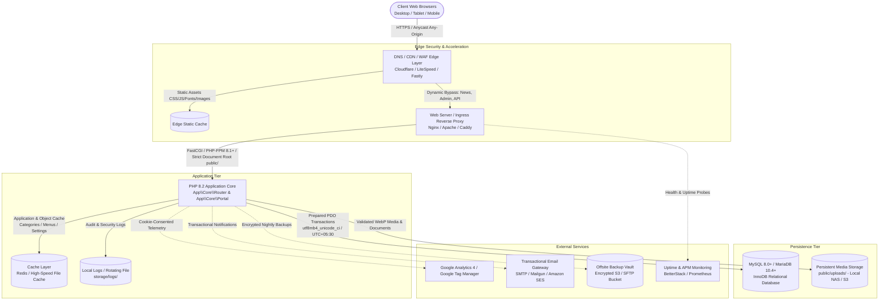

# Production Architecture & Operations Manual
**Platform:** Multilingual News Portal & Classified Advertisement Platform  
**Target Languages:** Sinhala (`si`), Tamil (`ta`), English (`en`)  
**Scope Boundary:** Web application only (Desktop, Tablet, Mobile Web). Native mobile applications (Android/iOS) are strictly out of scope.

---

## 1. High-Level Production Architecture

The platform is designed as a secure, high-throughput, low-latency web architecture optimized for news readership spikes, classified marketplace transactions, and trilingual content delivery.



### 1.1 Detailed Request Flow

1. **Client Browsers:**
   * Readers connect via HTTPS using modern web standards.
   * Responsive layout adapts dynamically across Desktop (1200px+), Tablet (768px), and Mobile (375px+).
   * Static assets (CSS, JS, WebP images, fonts) are loaded with browser-cache headers (`mod_expires`).
2. **DNS / CDN / WAF (Edge Layer):**
   * Anycast DNS resolves the domain with DDoS protection and Layer 7 Web Application Firewall (WAF) filtering.
   * Edge caching terminates SSL/TLS certificates and caches static assets globally.
   * Dynamic requests (including news feeds, article views, search queries, authenticated member workflows, and newsroom CMS actions) pass through to the origin server.
3. **Web Server (Ingress & Isolation):**
   * Apache with `mod_rewrite` or Nginx handles requests.
   * **Document root is strictly locked to `public/`**. Application code, `.env`, configuration, `storage/`, database migrations, and backups remain isolated above the public web root.
   * Direct execution of scripts inside `public/uploads/` is blocked via server configuration.
4. **PHP Application Core (Runtime):**
   * Front Controller (`public/index.php`) loads `app/bootstrap.php`, configures isolated session storage, initiates security headers (`X-Content-Type-Options: nosniff`, `X-Frame-Options: SAMEORIGIN`, `Referrer-Policy: strict-origin-when-cross-origin`, and `Strict-Transport-Security`), and validates CSRF tokens on all POST requests.
   * `App\Core\Router` resolves the route to the appropriate controller.
   * `App\Core\Portal` enforces Role-Based Access Control (`super_admin`, `editor`, `reporter`, `member`).
5. **Cache Layer:**
   * High-frequency configuration items (active categories, navigation menus, and site settings) are resolved through `App\Core\Cache`.
   * Supports `redis` (connecting via PHP Redis extension to an in-memory instance) or atomic `file` storage with TTL-based expiration.
   * Cache entries are automatically invalidated upon administrative edits in the newsroom.
6. **Persistence Layer (MySQL / MariaDB):**
   * Primary relational store configured with `utf8mb4_unicode_ci` and native Colombo timezone (`+05:30`).
   * Compound indexes support rapid filtering on article status, publication timestamps, and category desks.
7. **Media Storage:**
   * Media files are transcoded to WebP via GD, validated by binary magic bytes (`fileinfo`), assigned unguessable random hexadecimal filenames, and stored under `public/uploads/YYYY/MM/`.

### 1.2 Authentication Lifecycle & Session Security

* **Session Configuration:** PHP native sessions stored in isolated directory `storage/sessions/` with strict mode (`session.use_strict_mode = 1`) and garbage collection (`session.gc_maxlifetime = 86400`).
* **Cookie Policy:** Enforced `HttpOnly = true`, `SameSite = Lax`, and `Secure = true` when served over HTTPS. `Strict-Transport-Security` header (HSTS, max-age 1 year) enabled on production.
* **Authentication Flow:** Passwords hashed with `PASSWORD_DEFAULT` (bcrypt 60-char salts). Login attempts throttled by dual persistent SHA-256 buckets (IP bucket max 10/15min, Account bucket max 5/15min) preventing credential stuffing.
* **Disabled Account Invalidation:** On every authenticated request, `Portal::__construct()` verifies `u.status = 'active'`. If an account is suspended or deactivated by an administrator, the session is immediately invalidated without waiting for cookie expiration.
* **CSRF Protection:** Cryptographically secure 32-byte token generated per session (`$_SESSION['csrf']`), verified via timing-safe `hash_equals()` on all POST mutations.
* **Session Destruction:** User logout explicitly wipes `$_SESSION`, destroys the session record on disk, issues an expired cookie header, and regenerates the session ID.

### 1.3 Media Storage & Upload Pipeline

* **Public Uploads Directory:** Stored under `public/uploads/YYYY/MM/` partitioned by year and month.
* **Validation & Sanitization:** Binary magic bytes checked using `finfo(FILEINFO_MIME_TYPE)` (not relying on file extensions). Only permitted MIME types: JPG, PNG, WebP, GIF, PDF, MP4, WebM.
* **Image Optimization:** Automated transcoding to WebP (quality 82) via GD library. Downscales images exceeding 2,000px width/height while preserving aspect ratios. Enforces 24 megapixel safety limit to prevent memory decompression bombs.
* **Unguessable Identifiers:** Files renamed to 36-character random hex strings (`bin2hex(random_bytes(18))`), completely decoupling user filenames from disk paths.
* **Script Execution Lockdown:** Protected by `public/uploads/.htaccess` with `Options -Indexes -ExecCGI` and `Require all denied` on all executable extensions (`.php`, `.phtml`, `.phar`, `.cgi`, `.sh`).
* **Persistent Cloud Storage Architecture:** Single-server VPS uses local storage; clustered or multi-node production uses S3-compatible object storage (e.g., AWS S3, Cloudflare R2, MinIO) with public CDN distribution.

### 1.4 Caching Subsystem (Web Only)

* **Multi-Driver Cache:** `App\Core\Cache` provides unified interface supporting `none` (development), `file` (atomic filesystem storage in `storage/cache/`), and `redis` (connecting via PHP Redis extension to an in-memory instance).
* **High-Frequency Objects:** Navigation menus (`portal_menus`), active categories (`portal_categories`), and site settings (`portal_settings`) cached with 600-second TTL.
* **Event-Driven Cache Invalidation:** Administrative updates in the newsroom (category edits, menu changes, setting adjustments, article publishing) trigger explicit `Cache::delete()` calls to ensure immediate reader consistency.
* **Static Browser Caching:** Apache/Nginx configuration leverages `mod_expires` (1 hour for CSS/JS, 7 days for images/WebP) and `mod_deflate` for gzip compression.
* **Strict Scope Constraint:** No SEO caching, Google bot caches, or search engine sitemap caches are implemented.

### 1.5 Structured Logging & Audit Trails

The platform logs all operational, security, and administrative events to structured log files (`storage/logs/app.log` and `storage/logs/error.log`):
* **Application Errors:** Centralized try-catch in Front Controller and PHP `set_error_handler` log full exception traces and request URIs with HTTP 500 error code.
* **Authentication Events:** Login rate-limiting triggers, failed sign-in attempts, successful authentications, new member registrations, and sign-outs logged with sanitized context.
* **Publishing Actions:** Story draft creations, updates, editor approvals, status transitions, revision restorations, and article archiving recorded with story ID and user attribution.
* **Moderation Actions:** Classified advertisement approvals, rejections, withdrawals, and renewals logged with moderation notes.
* **Admin Changes:** Category modifications, navigation menu updates, user role assignments, banner advertisement state changes, and payment records audited.
* **Scheduled Tasks:** Execution of scheduled task runner (`bin/cron.php`) and automated backup snapshots (`bin/backup.php`) logged with item counts and timestamps.
* **Sensitive Data Redaction:** Automatically strips passwords, tokens, credit card numbers, and authorization headers before persisting log entries.

### 1.6 Scheduled Task Architecture

Configured through Linux crontab executing `php bin/cron.php` CLI tool:
* **Article Publication:** Transitions scheduled articles (`status='scheduled'` and `published_at <= NOW()`) to `'published'`, flushing portal caches.
* **Classified Expiration:** Transitions active classifieds (`status='approved'` and `expires_at <= NOW()`) to `'expired'`.
* **Ad Campaign Maintenance:** Automatically deactivates expired banner campaigns whose end dates have passed.
* **Rate-Limit Pruning:** Deletes stale login attempt records older than 24 hours.
* **Cache Garbage Collection:** Removes expired file-based cache entries from `storage/cache/`.
* **Nightly Backups:** Executes `bin/backup.php` during off-peak hours (02:00 AM Colombo time), producing transactional database dumps and upload archives in `storage/backups/`.

---

## 2. Environment Matrix

| Parameter | Local Development | Staging Environment | Production Environment |
| :--- | :--- | :--- | :--- |
| **`APP_ENV`** | `local` or `demo` | `staging` | `production` |
| **`APP_DEBUG`** | `true` | `false` | `false` (Strictly disabled) |
| **`APP_URL`** | `http://127.0.0.1:8080` | `https://staging.example.lk` | `https://news.example.lk` |
| **`DB_DRIVER`** | `sqlite` or `mysql` | `mysql` | `mysql` |
| **`DB_HOST`** | `127.0.0.1` | `127.0.0.1` / Private IP | Private RDS / Clustered IP |
| **`DB_NAME`** | `storage/preview.sqlite` or `news_hub_dev` | `news_hub_staging` | `news_hub_prod` |
| **`SESSION_SECURE_COOKIE`** | `false` (HTTP permitted) | `true` (HTTPS enforced) | `true` (Strict HTTPS) |
| **`SESSION_LIFETIME`** | `86400` (24 hours) | `86400` (24 hours) | `86400` (24 hours) |
| **`CACHE_DRIVER`** | `none` or `file` | `file` or `redis` | `redis` (or `file`) |
| **`LOG_CHANNEL`** | `file` (Verbose console + file) | `file` (`storage/logs/`) | `file` (`storage/logs/` + Syslog) |
| **Error Display** | Visible on screen | Generic 500 page; logged to file | Generic 500 page; logged to file |

---

## 3. Deployment Prerequisites & Server Requirements

### 3.1 Operating System & Server Packages
* **Operating System:** Linux (Ubuntu 22.04 LTS / 24.04 LTS or Rocky Linux 9 recommended).
* **Web Server:** Nginx 1.20+ or Apache 2.4+ with `mod_rewrite`, `mod_headers`, `mod_deflate`, and `mod_expires`.
* **PHP Runtime:** PHP 8.1 or PHP 8.2 (tested and certified on PHP 8.2.12).
* **Required PHP Extensions:**
  * `pdo_mysql` (Database connectivity)
  * `pdo_sqlite` (Testing and preview support)
  * `mbstring` (Multilingual UTF-8 character processing for Sinhala & Tamil)
  * `dom` & `libxml` (Strict rich-text HTML sanitization)
  * `fileinfo` (Binary MIME magic byte validation)
  * `gd` with WebP support (Image scaling, compression, WebP conversion)
  * `zip` (Backup archive generation)
  * `redis` (Optional, required if `CACHE_DRIVER=redis`)
* **Database Engine:** MySQL 8.0+ or MariaDB 10.4+ with InnoDB engine and `utf8mb4` character set support.

### 3.2 File Permissions & Directory Ownership
Ensure the web server process user (`www-data` or `nginx`) has appropriate permissions:
```bash
# Set base directory ownership
chown -R www-data:www-data /var/www/news_page

# Restrict configuration and sensitive directories
chmod 750 /var/www/news_page
chmod 600 /var/www/news_page/.env

# Grant write access only to required storage and upload paths
chmod -R 775 /var/www/news_page/storage
chmod -R 775 /var/www/news_page/public/uploads
```

---

## 4. Production Configuration Checklist

Before routing live production traffic, verify each item:

- [ ] **Document Root:** Web server document root points strictly to `/path/to/news_page/public`. Ensure `.env`, `storage/`, and `database/` are inaccessible from the web.
- [ ] **Environment File:** `.env` exists, permissions set to `0600`, owned by the web worker user.
- [ ] **Debug Mode:** `APP_DEBUG=false` in `.env`.
- [ ] **Environment Mode:** `APP_ENV=production` in `.env`.
- [ ] **Application URL:** `APP_URL` matches the canonical public HTTPS URL without trailing slash (`https://news.example.lk`).
- [ ] **SSL/TLS Certificates:** Valid SSL certificate installed; HTTP traffic automatically redirects to HTTPS (301).
- [ ] **Secure Cookies:** `SESSION_SECURE_COOKIE=true` in `.env`.
- [ ] **Database Credentials:** Dedicated database user with privileges restricted strictly to the application database.
- [ ] **Initial Administrator:** Created via CLI using `bin/admin.php` with a strong 16+ character password. No default credentials exist.
- [ ] **PHP Limits:** `upload_max_filesize=25M`, `post_max_size=210M`, `memory_limit=256M` configured in PHP runtime.
- [ ] **Uploads Protection:** `public/uploads/.htaccess` is active and script execution (`.php`, `.phtml`, `.phar`) is blocked.
- [ ] **Cron / Scheduler:** Automated maintenance command (`php bin/cron.php`) scheduled in crontab every 5–15 minutes, with nightly backup (`php bin/cron.php --backup`) at 02:00 AM Colombo time.
- [ ] **Log Rotation:** System `logrotate` configured for `storage/logs/*.log`.

---

## 5. Staging Configuration Checklist

Staging mirrors production as closely as possible while maintaining isolation:

- [ ] **Isolated Database:** Staging uses a completely separate database (`news_hub_staging`), never sharing credentials with production.
- [ ] **Sanitized Data:** Production backups imported to staging must have member emails and contact phones anonymized.
- [ ] **No Live AdSense:** AdSense scripts disabled or replaced with sample test campaigns in `/admin/advertisements`.
- [ ] **Robots Exclusion:** Staging domain blocks web crawlers (`X-Robots-Tag: noindex, nofollow`).
- [ ] **Authentication Boundary:** Staging admin accounts utilize unique passwords distinct from production credentials.

---

## 6. Database Migration & Maintenance Procedures

### 6.1 Executing Migrations
All database schema changes are additive, idempotent, and executed strictly through the CLI:

```bash
cd /var/www/news_page
php database/migrate.php
```

**Verification:**
* The migration script checks table and column existence before altering.
* It verifies and records version tokens in the `schema_versions` table.
* It preserves existing articles, categories, users, and classified listings without data loss.

### 6.2 Pre-Migration Backup Requirement
Always generate a pre-migration backup snapshot before applying schema updates:
```bash
php bin/backup.php
```
This produces a consistent transactional SQL dump and uploads snapshot in `storage/backups/news-YYYYMMDD-HHMMSS-XXXXXX.zip`.

---

## 7. Rollback Procedure

In the event of an operational failure during deployment:

### 7.1 Application Code Rollback
1. Revert web server symlink or git commit to the previous stable release tag:
   ```bash
   git checkout tags/v1.0.0
   ```
2. Clear file cache or flush Redis:
   ```bash
   rm -f storage/cache/*.cache
   # or redis-cli -a <password> flushdb
   ```
3. Restart PHP-FPM:
   ```bash
   sudo systemctl restart php8.2-fpm
   ```

### 7.2 Database Rollback
Because database migrations are designed to be backward-additive, rolling back application code does not require dropping new columns immediately. However, if a complete database restoration is required:
1. Put application in maintenance mode or temporarily point traffic to a maintenance page.
2. Locate the pre-deployment archive under `storage/backups/`.
3. Import the clean SQL snapshot:
   ```bash
   mysql -u <user> -p <database_name> < storage/backups/news-<timestamp>.sql
   ```
4. Verify data integrity and resume traffic.

---

## 8. Open Infrastructure & Architectural Decisions

The following infrastructure decisions should be finalized based on hosting budget and operational preferences:

1. **Edge CDN Provider:**
   * *Option A (Cloudflare Pro / Enterprise):* Provides turnkey Sri Lanka PoP caching, Web Application Firewall (WAF), and automatic DDoS mitigation.
   * *Option B (LiteSpeed Cache / OpenLiteSpeed):* Direct server-level page caching with minimal external dependencies.
2. **Object Storage for Media:**
   * *Current Baseline:* Local filesystem under `public/uploads/` with WebP compression. Optimal for single VPS.
   * *Scale Recommendation:* For multi-node autoscaling, mount an S3-compatible bucket (e.g., AWS S3, Cloudflare R2, Wasabi) or shared NFS volume.
3. **Session Clustering:**
   * *Current Baseline:* File-based sessions under `storage/sessions`.
   * *Scale Recommendation:* When adding multiple web workers behind a load balancer, configure `session.save_handler = redis` pointing to a central Redis cluster.
4. **Transactional Email Service:**
   * Configure SMTP credentials in `.env` (Mailgun, SendGrid, Amazon SES, or local Postfix) for classified status notifications and contact inquiry routing.
